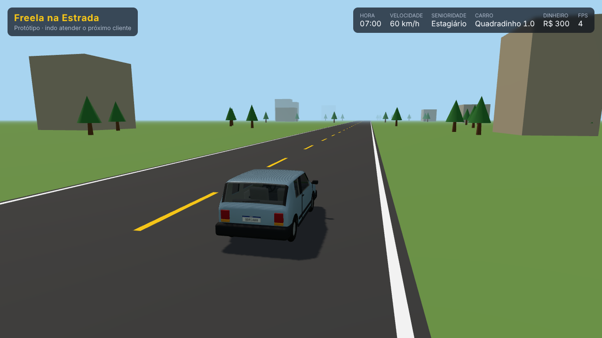

# Freela na Estrada

Jogo de direção no navegador em que você é um **dev freelancer em Osasco e Cotia (SP)**. Você começa
como **estagiário**, com um carro caindo aos pedaços, aceitando jobs ruins ("dirigir 38 km para
centralizar uma div por R$ 35"), chega no cliente com o notebook e **coda as tasks de verdade**. Para
crescer, aprende **HTML, CSS, JavaScript, Node.js e TypeScript**.

> Status: **em desenvolvimento, já jogável**. Abra o celular (`J`), aceite um job, dirija até o feixe
> de luz do cliente (ou deixe o piloto automático levar), resolva as tasks no notebook e entregue: o
> SLA vira estrelas e o pagamento cai na conta. O currículo está completo (19 módulos, 82 lições, 216
> exercícios, 1089 perguntas e 76 jobs) e todos os exercícios são corrigidos de verdade (JS/TS num
> Worker, HTML/CSS/DOM num iframe). Por enquanto a estrada é um circuito no estilo Slow Roads; o mapa
> real de Osasco e Cotia, posto, pedágio, blitz e promoção vêm a seguir. Plano em [`PLANO.md`](PLANO.md).



## O jogo

**O dia do dev**

1. De manhã, o app de freelas no celular mostra os jobs do dia: cliente, bairro, distância, pagamento e
   prazo.
2. Você monta a rota e dirige por Osasco e Cotia: trânsito, pedágios, blitz, posto e pneu careca.
3. No cliente, estaciona, entra com o notebook e abre o editor. Ali estão o kanban de tasks, o chat do
   cliente (que adora aumentar o escopo), o preview do site e os testes.
4. Entregou: recebe o pagamento e uma avaliação em estrelas.

**SLA e efetivação**

- Cada job tem um SLA: o tempo, contado da chegada no cliente, para entregar todas as tasks. Quanto
  mais adiantado, mais estrelas (5 se usar até 75% do tempo; 1 se passar de 160%).
- Os últimos 10 jobs definem a chance de ser chamado para a **entrevista** do próximo degrau: 60% com o
  SLA no limite, subindo ou caindo 15 pontos a cada 10% adiantado ou atrasado. Ficar muito abaixo do
  SLA dificulta a efetivação.

**Senioridade e trilhas**

| Senioridade | O que estuda                  | Jobs típicos                                        |
| ----------- | ----------------------------- | --------------------------------------------------- |
| Estagiário  | HTML → CSS → JS               | centralizar div, trocar cor de botão, arrumar link  |
| Júnior      | escolhe **Front** ou **Back** | landing page, formulário / script Node, API simples |
| Pleno       | TypeScript                    | sistemas maiores, refatorações                      |
| Sênior      | libera a outra trilha         | jobs grandes, code review                           |
| Full Stack  | front + back + TS             | os melhores clientes                                |

**Nada vem de graça: tudo exige código ou perguntas**

| Situação        | Para seguir                                                         |
| --------------- | ------------------------------------------------------------------- |
| Abastecer       | resolver um exercício                                               |
| Pedágio e blitz | responder perguntas sobre o que estudou e os jobs recentes          |
| Sono e hotel    | responder perguntas no check-in                                     |
| Pane do carro   | chamar o mecânico (caro) ou corrigir um código com defeito (barato) |
| Promoção        | entrevista técnica                                                  |
| Carro novo      | dinheiro e um desafio de código                                     |

**Carros**

São modelos fictícios inspirados em carros brasileiros, sem nomes nem logos reais.

| Inspirado em     | No jogo         | Senioridade | Modelo 3D        |
| ---------------- | --------------- | ----------- | ---------------- |
| Uno              | Quadradinho 1.0 | Estagiário  | pronto (Blender) |
| Gol quadrado     | Quadradão 1.6   | Júnior      | pronto (HanabLS) |
| Opala            | Safira 4.1      | Pleno       | pronto (HanabLS) |
| Vectra           | Vetor 2.0       | Pleno       | a fazer          |
| Versa            | Verso 1.6       | Sênior      | a fazer          |
| BYD Dolphin Mini | Golfinho Mini   | Sênior      | a fazer          |
| BYD Song         | Canção Híbrido  | Full Stack  | a fazer          |

**Personalização:** aparência do dev, carro (cor, rodas, adesivos, buzina), notebook (tema, fonte,
adesivos), nome, apelido e bio.

## Como jogar

| Tecla                   | O que faz                                                  |
| ----------------------- | ---------------------------------------------------------- |
| `W` `A` `S` `D` / setas | dirigir (até tocar no teclado, o piloto automático dirige) |
| `Espaço`                | freia (parado, engata a ré)                                |
| `J`                     | celular: app de freelas                                    |
| `E`                     | volta ao notebook de um job em andamento                   |

No notebook: leia a task (ou a aba **Documentação**, que é a lição), edite o código, **Rodar testes**.
Cada task resolvida avança o kanban; o cliente pode pedir "só mais uma coisinha". Com tudo feito,
**Entregar job**. Dicas custam R$ 10.

## Visual

O estilo é de "estrada aberta", com referência no Slow Roads:

- relevo com morros em camadas;
- névoa colorida;
- árvores com casca e folhas fotográficas (mata, pinus e eucalipto);
- terra vermelha na beira da estrada;
- crepúsculo roxo.

Tudo é feito em Three.js e roda no navegador. Os carros e o personagem serão modelados no Blender (por
script) e exportados em glTF.

Para ver a prévia:

```bash
npm install
npm run dev
# abra http://localhost:5173/preview/estilo.html            (fim de tarde, atrás do carro)
#      http://localhost:5173/preview/estilo.html?view=vista (vista do alto)
#      http://localhost:5173/preview/estilo.html?time=dusk  (crepúsculo)
#      http://localhost:5173/preview/estilo.html?view=dentro (de dentro do carro)
#      http://localhost:5173/preview/garagem.html?angulo=frente&cor=8fb0c4 (carro em estúdio; também tras, lado, dentro)
#      http://localhost:5173/preview/provador.html?skin=devMale&anim=Run (o dev; anim: Idle, Run, Jump)
#      http://localhost:5173/preview/telas.html?tela=app    (também: notebook, criador)
```

Para gerar as imagens da prévia, rode `npx tsx preview/capture.ts <pasta> "estilo.html?view=vista"`.

Os carros são gerados por script no Blender (o Blender como módulo Python):

```bash
pip install bpy pillow
python tools/blender/quadradinho.py public/models/carros/quadradinho.glb
tools/blender/build-models.sh   # carro + personagem (baixa o pacote do Kenney)
```

## Desenvolvimento

```bash
npm install
npm run dev               # http://localhost:5173  (?qualidade=baixa|media|alta)
                          # ?perto: cliente logo à frente · ?job=core.m03.j01: põe um job no app
npm run format:check
npm run lint
npm run typecheck
npm test                  # unidade (Vitest)
npm run validate:content  # regras do conteúdo didático
npm run e2e               # navegador (Playwright)
```

| Pasta                   | O que tem                                                                                           |
| ----------------------- | --------------------------------------------------------------------------------------------------- |
| `src/shared/`           | contratos entre os módulos e `balance.ts` (todos os números de balanceamento)                       |
| `src/core/`             | barramento de eventos, loop do jogo, save                                                           |
| `src/edu/runner/`       | executor de exercícios que imita o Node (fs, path, events, assert, timers) e checa tipos TypeScript |
| `src/edu/web/`          | runtime dos exercícios web (HTML/CSS/DOM), rodados no Chromium pelo validador                       |
| `src/edu/validation.ts` | regras de qualidade do conteúdo e dos jobs (`content/README.md` explica como escrever)              |
| `src/gameplay/`         | regras de carreira: SLA, estrelas, reputação e promoção                                             |
| `preview/`              | prévias visuais (estrada, rua e telas) e o script de captura                                        |
| `tools/blender/`        | carros modelados por script no Blender, exportados em glTF para `public/models/`                    |

## Créditos

- Dados de mapa: © colaboradores do OpenStreetMap (ODbL).
- 3D: [Three.js](https://threejs.org) (MIT).
- Árvores e texturas de casca, folhas, grama e terra: [EZ-Tree](https://github.com/dgreenheck/ez-tree),
  de Daniel Greenheck (MIT).
- Personagem e carros do trânsito: [Kenney](https://www.kenney.nl) (CC0): Animated Characters 2 e Car Kit.
- Quadradão e Safira: modelos do HanabLS, renomeados. Licença não declarada: precisa da autorização do
  autor antes de publicar o jogo (detalhes em `public/models/carros/CREDITOS.md`).
- Inspiração visual: Slow Roads. Nenhum código ou asset do jogo é usado.
